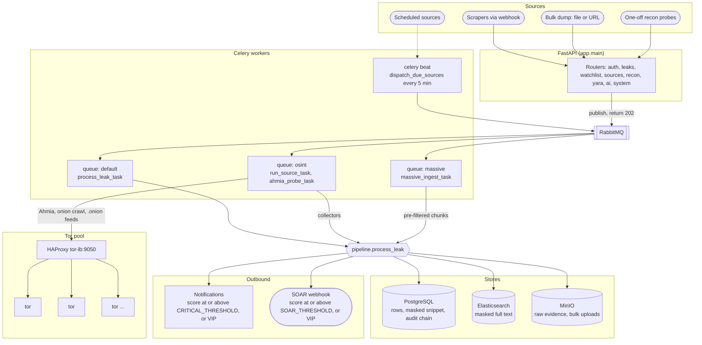

# Architecture

An API that accepts work and returns, a broker, three Celery queues, three
datastores and a Tor pool. Ingestion is decoupled from analysis: the API
publishes a message to RabbitMQ and answers `202`; a worker runs the pipeline.

## System overview

With no `RABBITMQ_URL` (or `PIPELINE_INLINE=true`) the broker and the workers
drop out of this picture: the API calls the same functions in-process. That is
how the test suite runs, and it is fine on a laptop. It is not a production
mode — see [Degraded modes](#degraded-modes).

## 1. API (FastAPI)

`backend/app/main.py`. Async throughout: SQLAlchemy 2.0's async API, `asyncpg`
against PostgreSQL (or `aiosqlite` for tests and development).

- **Connection pool.** The API keeps a pool of `DB_POOL_SIZE` (20) plus
  `DB_MAX_OVERFLOW` (10). Workers use `NullPool` instead, because each Celery
  task runs on a fresh event loop and an `asyncpg` connection opened on a dead
  loop deadlocks when reused (`database.make_engine`).
- **Bootstrap.** On startup the API runs `Base.metadata.create_all` and, on an
  empty `users` table, creates tenant `Default`, an admin from
  `ADMIN_EMAIL`/`ADMIN_PASSWORD` who is also the only platform admin, and one
  Ahmia sweep source. There are no
  migrations — see [Known gaps](/guide/security#known-gaps).
- **Middleware.** `TrustedHostMiddleware` (`ALLOWED_HOSTS`), CORS
  (`CORS_ORIGINS`, credentials allowed, headers limited to `Authorization`,
  `Content-Type`, `X-SYS-CSRF`, `X-API-Key`), and a response hook that sets
  `X-Content-Type-Options: nosniff`, `X-Frame-Options: DENY`,
  `Referrer-Policy: no-referrer` and `Content-Security-Policy: default-src
  'none'; frame-ancestors 'none'` on everything except the interactive docs.
- **Interactive docs.** `/api/docs`, `/api/redoc` and `/api/openapi.json`
  exist only when `ENV` is not `production`.
- **Handing off work.** `services/broker.py` publishes a Celery protocol-2
  message directly onto RabbitMQ with `aio_pika`, body serialised by `orjson`,
  persistent delivery, one shared robust connection per API process and a
  short-lived channel per publish. The API never imports Celery to send.

## 2. Workers (Celery)

`backend/app/worker/`. Three queues, each a direct exchange of the same name:

| Queue | Tasks | Intended concurrency | Purpose |
|---|---|---|---|
| `default` | `process_leak_task` | several | one webhook item through the pipeline |
| `osint` | `run_source_task`, `ahmia_probe_task` | several | collectors: Ahmia, onion crawl, Telegram, GitHub, HIBP, feeds |
| `massive` | `massive_ingest_task` | **1** | streaming bulk dumps, so one huge job cannot starve the per-leak queue |

Beat schedules two periodic tasks: `dispatch_due_sources` every five minutes and
`purge_revoked_tokens` hourly at minute 7.

Settings that apply to every task: `worker_prefetch_multiplier=1`,
`task_acks_late=True` and `task_reject_on_worker_lost=True` (a crash re-delivers
rather than drops), and a **900-second hard / 840-second soft time limit** by
default. `massive_ingest_task` overrides it with 6 hours hard and 6 hours minus
60 seconds soft; see [Ingestion](/guide/ingestion#limits).

`process_leak_task` retries up to three times, 60 seconds apart, on any error
other than a rejected (empty) candidate. Re-processing is safe because the
SHA-256 dedup turns a retry of an already-committed leak into a sighting.

Concurrency per queue is set on the worker command line, not in the code. The
values above are the intent; check them against your compose file.

## 3. Stores

### PostgreSQL

Tenants, users, API keys, the JWT revocation list, watch items, sources, source
runs, YARA rules, leaks (with the **masked** snippet, entities, YARA and
watchlist matches, AI verdict, CTI), notifications, investigation plans and the
audit chain. Ids are UUID strings so the same schema runs on SQLite.

### Elasticsearch (optional)

One index, `ES_INDEX` (`secyourscan-leaks`), created on first use with one shard
and no replicas and `dynamic: false`. Each document is the **masked** text (up to
200,000 characters) plus keyword fields for tenant, source, status, category,
emails, domains, IPs, wallets, watchlist hits and YARA rule names. Unlike naso,
which indexes into Elasticsearch and never reads it back, `GET /leaks/search`
queries it. Enabled only when both `ES_URL` and `ES_PASSWORD` are set.

### MinIO / S3 (optional)

One bucket per tenant, `tenant-<tenant_id>`, holding the raw content of every
leak at `leaks/<sha256>.txt` and bulk uploads at `bulk/<uuid>-<filename>`. A
bucket per tenant lets the deletion saga drop a bucket rather than filter
objects. Enabled only when `MINIO_ENDPOINT`, `MINIO_ACCESS_KEY` and
`MINIO_SECRET_KEY` are all set.

### Tenant deletion saga

`DELETE /tenants/{id}` (platform admin only) queues `delete_tenant_saga`,
which runs, in order:

1. delete-by-query of the tenant's Elasticsearch documents;
2. removal of every object in the tenant's bucket, then the bucket;
3. relational deletes in PostgreSQL — tasks, leaks, notifications, source runs,
   sources, watch items, API keys, plans, YARA rules, users, **the tenant's
   audit rows**, and the tenant.

It is a saga, not a transaction: a failure part-way leaves the earlier steps
done, and the whole task is retried, up to five times, five minutes apart. Each
step is idempotent. Completion is recorded as `DELETE_TENANT_COMPLETED` in the
global (tenant-less) audit chain, since the tenant's own chain no longer exists.

## 4. Tor pool

`infrastructure/tor/`. A set of identical Alpine Tor containers, SOCKS only on
port 9050, accepting connections from RFC 1918 ranges only, `ExitRelay 0`, and
`IsolateDestAddr 1` so crawls of different sites do not share a circuit.

In front of them, HAProxy (`haproxy.cfg`) does round-robin TCP balancing with a
TCP health check. Its backend is a `server-template` of up to ten `tor:9050`
entries resolved through Docker's DNS, so `docker compose up --scale tor=N`
needs no configuration change.

The application only sees `TOR_PROXY`, for example `socks5h://tor-lb:9050`. The
`h` matters: it makes DNS resolution happen at the Tor end, which `.onion`
addresses require.

What goes through Tor and what does not is listed on
[Dark Web Recon](/guide/dark-recon#what-goes-through-tor).

## 5. Circuit breakers

`services/breaker.py`. Three in-process breakers stop a dead dependency from
adding its timeout to every leak in the queue:

| Breaker | Opens after | Stays open |
|---|---|---|
| `elasticsearch` | 5 consecutive failures | 60 s |
| `minio` | 5 consecutive failures | 60 s |
| `ai` | 3 consecutive failures | 120 s |

After the open period the breaker is half-open: one success closes it, one
failure reopens it. State is per process, so each API process and each worker
process has its own view. `/system/health` reports the API process's breakers
under `circuits`.

## Degraded modes

Every optional component has a defined behaviour when it is missing:

| Missing | Effect |
|---|---|
| RabbitMQ | Pipeline runs inside the API process. **No scheduled sources** — beat needs the broker — and the AI's `dark_web_probe` tool is skipped. Tenant deletion runs synchronously in a thread. |
| MinIO | No raw evidence; `GET /leaks/{id}/evidence` answers `404`. Bulk *file* uploads answer `503`; bulk *URLs* still work. |
| Elasticsearch | `GET /leaks/search` answers from SQL `ILIKE` with `"engine": "sql"`. |
| Model server | Severity is rule-based only; `/ai/chat` emits an `error` event. |
| Tor | Ahmia is queried over the clearnet (recorded as `via_tor: false`); onion crawling and `.onion` feeds fail. |

The details of each are on [The Leak Pipeline](/guide/pipeline#degradation).
